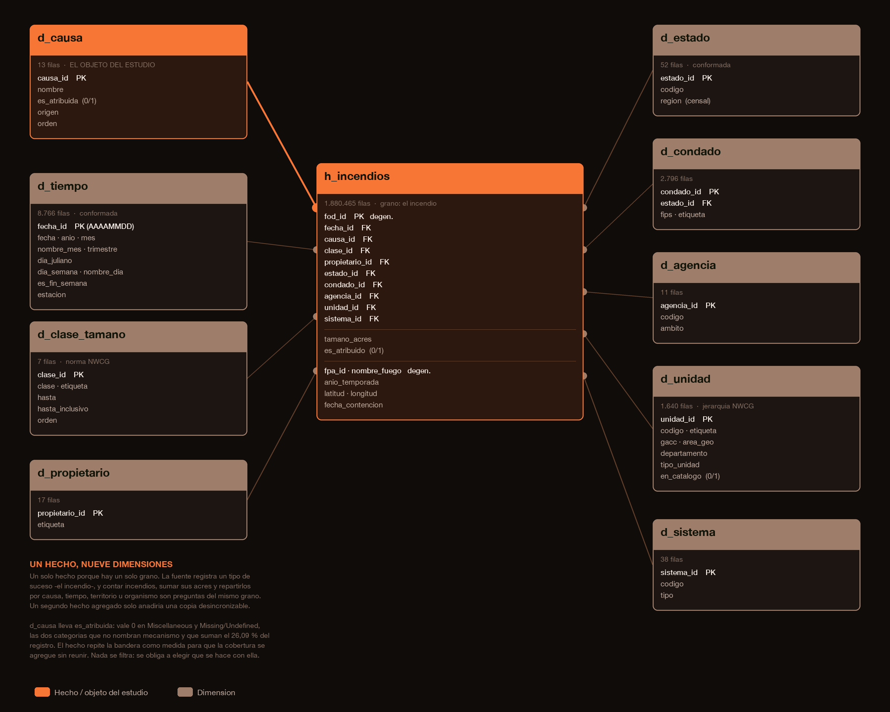

# El modelo dimensional

Esta etapa toma `fpa_normalizada.sqlite` —la entidad y sus nueve catálogos en
3FN— y construye `fpa_analitica.sqlite`: **nueve dimensiones, una tabla de
hechos y una tabla de parámetros**. Es el insumo del aplicativo y del tablero.

El script es [`modelo_dimensional.sql`](modelo_dimensional.sql):

```bash
sqlite3 fpa_analitica.sqlite < modelo_dimensional.sql
```

Tarda **5,0 segundos** y produce **295,4 MB**.



---

## Por qué desnormalizar lo que se acaba de normalizar

No es un paso atrás: son dos objetivos opuestos.

La 3FN optimiza la **escritura**. Cada hecho vive en un solo lugar, de modo que
no puede contradecirse consigo mismo. A cambio, responder «qué proporción de los
incendios por rayo ocurre en el Oeste» exige recorrer `incendios`, `causas` y
`estados` con reuniones sucesivas sobre 1,88 millones de filas.

El esquema en estrella optimiza la **lectura** y, sobre todo, la **comprensión**:
separa lo que se mide de aquello *por lo que* se mide. Esa separación obliga a
declarar en voz alta cuál es la unidad de análisis, que es justo lo que un
trabajo estadístico tiene que dejar explícito.

---

## Un solo hecho, un solo grano

Otros trabajos de esta serie necesitaron **tres** tablas de hechos porque tenían
tres granos distintos —la colisión, el conductor, la víctima—. Aquí no.

La fuente registra **un solo tipo de suceso**, el incendio, y las siete preguntas
de la investigación se responden a ese grano: contar incendios, sumar sus acres y
repartirlos por causa, por tiempo, por territorio o por organismo.

Inventar un segundo hecho agregado —por ejemplo «causa × año»— solo añadiría una
copia que puede quedar desincronizada con la primera. Las agregaciones se
calculan en la consulta, que es donde pertenecen.

| | |
|---|---:|
| `h_incendios` | **1.880.465 filas** |
| Acres totales | 140.132.550 |
| Periodo | 1992-01-01 a 2015-12-31 |
| Cobertura de la atribución | **73,91 %** |

---

## La bandera que atraviesa todo el modelo

`d_causa.es_atribuida` distingue las **once causas que nombran un mecanismo** de
las **dos que no lo nombran** —`Miscellaneous` y `Missing/Undefined`, que suman
el 26,09 % del registro—.

El hecho **repite** esa bandera como medida `es_atribuido`. No es redundancia
descuidada: permite que la cobertura se promedie y se agregue directamente —
`AVG(es_atribuido)` sobre cualquier corte da el porcentaje de atribución de ese
corte— sin reunir con la dimensión. Es el instrumento del objetivo 1.

La bandera **no filtra nada**. Obliga a elegir.

---

## Las nueve dimensiones

**Conformadas** (compartidas, con las mismas claves y etiquetas): `d_tiempo`,
`d_estado`.

| Dimensión | Filas | Nota |
|---|---:|---|
| `d_tiempo` | 8.766 | un día por fila; `fecha_id` = AAAAMMDD |
| `d_causa` | 13 | **el objeto del estudio** |
| `d_clase_tamano` | 7 | rangos de la norma NWCG |
| `d_propietario` | 17 | 16 del catálogo + «Sin dato» |
| `d_estado` | 52 | 50 estados + DC + Puerto Rico |
| `d_condado` | 2.796 | 2.795 + «Sin dato» |
| `d_agencia` | 11 | con el ámbito institucional |
| `d_unidad` | 1.640 | jerarquía NWCG |
| `d_sistema` | 38 | sistema informático de procedencia |

Cuatro decisiones de diseño merecen explicación.

**`d_tiempo` lleva `dia_juliano`.** Es la columna del objetivo 4. La
estacionalidad de cada causa se mide sobre el día del año, no sobre el mes,
porque la ventana de fuego no respeta los límites del calendario. Medida sobre el
mes, la ventana de `Fireworks` ocuparía «julio»; medida sobre el día juliano,
ocupa **nueve días**.

**`d_causa` lleva `origen`**, una clasificación que no está en la fuente: Natural
(solo `Lightning`), Antrópico (las otras diez atribuidas) y No atribuida (las
dos restantes). Permite reproducir la agregación habitual en la literatura sin
perder el detalle de las trece, y deja ver que la dicotomía humano/natural
esconde un tercer bloque del 26,09 %.

**`d_estado` lleva `region`**, asignada según la definición de las cuatro
regiones de la Oficina del Censo. Puerto Rico no pertenece a ninguna: es
territorio no incorporado y se rotula **`Territorio`** en lugar de forzarlo
dentro del Sur.

**`d_agencia` lleva `ambito`**, que agrupa los once organismos reportantes según
su naturaleza institucional —Federal, Estatal-Local, Interagencial, Tribal—. Es
la dimensión con la que el objetivo 1 mide el reparto desigual del hueco.

---

## Lo que este modelo deliberadamente no lleva

La fuente permite calcular la **duración de la campaña de extinción** a partir de
las fechas de descubrimiento y contención. **No se incorpora como medida**:
ninguno de los siete objetivos la pide, y es el objeto de otro trabajo de esta
misma serie. Las dos fechas quedan en el hecho por si una etapa posterior la
necesita, pero el modelo no la precalcula ni la presenta.

---

## Verificación

Integridad del esquema, medida sobre la base construida:

| Comprobación | Resultado |
|---|---|
| Filas en `h_incendios` | 1.880.465 — igual a la normalizada |
| Suma de `tamano_acres` | 140.132.550 — **idéntica al origen** |
| Incendios sin atribuir | 490.528 — igual al origen |
| Huérfanos de `d_tiempo` | 0 |
| `PRAGMA foreign_key_check` | sin violaciones |

Y los objetivos que esta etapa debía habilitar responden.

### Objetivo 1 — la cobertura no se reparte al azar

| Ámbito | Incendios | Atribuida |
|---|---:|---:|
| Tribal | 3.739 | 90,88 % |
| Federal | 477.795 | 84,33 % |
| **Estatal-Local** | **1.377.090** | 71,42 % |
| Interagencial | 21.841 | **0,11 %** |

### Objetivos 2 y 3 — frecuencia contra magnitud

Sobre las once causas atribuidas:

| Causa | Incendios | % | M acres | % acres | Media |
|---|---:|---:|---:|---:|---:|
| Debris Burning | 429.028 | 30,87 % | 5,98 | 5,11 % | 13,9 |
| Arson | 281.455 | 20,25 % | 9,49 | 8,11 % | 33,7 |
| **Lightning** | 278.468 | 20,03 % | **87,03** | **74,40 %** | **312,5** |
| Equipment Use | 147.612 | 10,62 % | 6,80 | 5,81 % | 46,1 |
| Campfire | 76.139 | 5,48 % | 3,43 | 2,93 % | 45,0 |
| Children | 61.167 | 4,40 % | 0,47 | 0,40 % | 7,7 |
| Smoking | 52.869 | 3,80 % | 0,84 | 0,72 % | 15,9 |
| Railroad | 33.455 | 2,41 % | 0,85 | 0,73 % | 25,4 |
| Powerline | 14.448 | 1,04 % | 1,61 | 1,38 % | **111,4** |
| Fireworks | 11.500 | 0,83 % | 0,32 | 0,27 % | 27,7 |
| Structure | 3.796 | 0,27 % | 0,17 | 0,15 % | 45,4 |

Frecuencia y magnitud apuntan en direcciones distintas. `Debris Burning` produce
una de cada tres campañas atribuidas y quema el 5,11 % de la superficie;
`Lightning` produce una de cada cinco y quema **tres cuartas partes**. `Powerline`
es el caso más extremo del contraste: el 1,04 % de los incendios, pero la segunda
superficie media más alta de todas.

### Objetivo 4 — la ventana estacional

Amplitud en días del 50 % central de los eventos de cada causa:

| Causa | Día 25 % | Día 75 % | Amplitud |
|---|---:|---:|---:|
| **Fireworks** | 179 | 188 | **9 días** |
| Lightning | 182 | 227 | 45 |
| Children | 91 | 216 | 125 |
| Railroad | 73 | 199 | 126 |
| Campfire | 116 | 248 | 132 |
| Debris Burning | 68 | 221 | 153 |
| Arson | 76 | 241 | 165 |

La ventana de `Fireworks` —del día 179 al 188— **es la semana del 4 de julio**. El
modelo la encuentra sin que nadie se la indique, lo que sirve de validación de la
dimensión temporal. En el otro extremo, `Arson` se reparte por 165 días: el
incendio provocado no tiene temporada.

### Objetivo 5 — la firma territorial

| Causa | Región dominante | % de la causa |
|---|---|---:|
| Lightning | Oeste | 76,3 % |
| Debris Burning | Sur | 74,6 % |
| Railroad | Sur | 73,9 % |
| Arson | Sur | 68,5 % |
| Campfire | Oeste | 57,0 % |
| Structure | Medio Oeste | 35,4 % |

### Objetivo 6 — por qué hay que leer dos veces

Participación de cada causa en dos tramos de doce años, calculada **sobre el
registro completo** y **sobre el subconjunto atribuido**:

| Causa | Todo 92-03 | Todo 04-15 | Atrib. 92-03 | Atrib. 04-15 |
|---|---:|---:|---:|---:|
| **Lightning** | 16,07 % | **13,65 %** | 20,29 % | **19,76 %** |
| Debris Burning | 22,32 % | 23,27 % | 28,19 % | **33,68 %** |
| Arson | 17,45 % | 12,69 % | 22,04 % | 18,37 % |

Leído sobre el total, `Lightning` **cae 2,4 puntos**. Leído sobre lo atribuido,
se mantiene plano: medio punto. La caída no era del rayo, era del hueco creciendo
por debajo. Y al revés: el crecimiento real de `Debris Burning` es de **5,5
puntos** sobre lo atribuido, casi seis veces el 0,95 que muestra el total.

Esta tabla es la justificación empírica de la regla metodológica que el README
anuncia: **cada resultado se presenta dos veces, y la distancia entre ambas
lecturas es ella misma un resultado.**

---

La etapa siguiente es la carga de esta base en **MotherDuck**, desde donde la
consumirá el tablero de Tableau.
