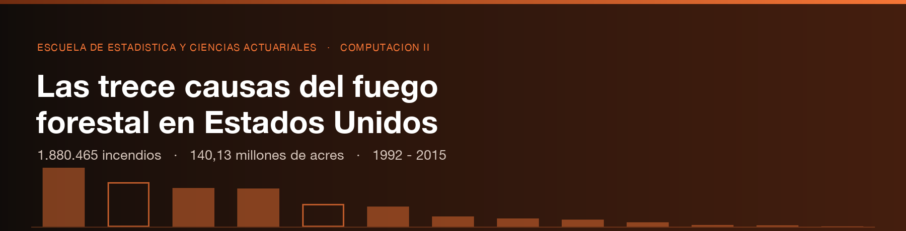

# Las trece causas del fuego forestal en Estados Unidos: perfil comparado y cobertura de la atribución (1992–2015)

Investigación estadística descriptiva sobre **1.880.465 incendios forestales
geo-referenciados** ocurridos en Estados Unidos entre 1992 y 2015, que suman
**140,13 millones de acres** de superficie quemada.

El registro federal clasifica cada incendio en **trece causas estadísticas**. Este
trabajo las describe una por una —frecuencia, magnitud, estacionalidad y
geografía— y, antes de eso, mide **cuántas de esas trece nombran realmente una
causa**.

---

## Planteamiento del problema

La literatura y la mayoría de los análisis públicos sobre la base FPA FOD agrupan
las causas en dos bloques: fuego humano y fuego natural. Esa agregación es útil
pero esconde dos cosas.

**La primera es que los trece valores no son trece causas.** Dos de ellos no
nombran ningún mecanismo:

| Categoría | Incendios | % del registro |
|---|---:|---:|
| `Miscellaneous` | 323.805 | 17,22 % |
| `Missing/Undefined` | 166.723 | 8,87 % |
| **Suma** | **490.528** | **26,09 %** |

Más de **uno de cada cuatro incendios del país carece de causa utilizable**. Todo
porcentaje que se calcule sobre el total sin descontar ese bloque está
atribuyendo a las once causas reales una participación que no les corresponde.

**La segunda es que ese hueco no se reparte al azar, ni se mantiene estable.**

Por agencia reportante, la atribución varía en un factor de ocho:

| Agencia | Ámbito | Incendios | Sin causa |
|---|---|---:|---:|
| Interagencial | Interagencial | 21.841 | **99,89 %** |
| Fish and Wildlife Service | Federal | 19.331 | 34,28 % |
| **Estatales, de condado y locales** | Estatal-Local | **1.377.090** | **28,58 %** |
| National Park Service | Federal | 20.893 | 20,15 % |
| Bureau of Land Management | Federal | 97.034 | 17,52 % |
| Bureau of Indian Affairs | Federal | 119.943 | 17,10 % |
| **Forest Service** | Federal | 220.497 | **11,99 %** |

Y en el tiempo, **el hueco crece**: pasa del 23,14 % en 1992 al 32,75 % en 2015,
con un máximo de 35,99 % en 2008. El registro no mejora su capacidad de atribuir
causa: la pierde.

> **Consecuencia metodológica que ordena todo el trabajo.** Las series de causa no
> pueden leerse como series de comportamiento. Una causa puede «caer» entre 1992 y
> 2015 simplemente porque el bloque sin atribuir creció diez puntos y se la comió.
> Por eso cada resultado de esta investigación se presenta **dos veces**: sobre el
> registro completo y sobre el subconjunto atribuido, y la distancia entre ambas
> lecturas es ella misma un resultado.

---

## Objetivo general

Describir el perfil estadístico comparado de las trece causas registradas del fuego
forestal en Estados Unidos entre 1992 y 2015 —en frecuencia, magnitud,
estacionalidad y distribución territorial—, estableciendo previamente el grado de
cobertura de la atribución de causa y su efecto sobre la lectura de los resultados.

---

## Objetivos específicos

1. **Medir la cobertura de la atribución de causa** sobre el universo completo, y
   su variación por agencia reportante, por estado y a lo largo de los 24 años.
2. **Caracterizar cada una de las trece causas** en frecuencia absoluta y relativa,
   superficie quemada, superficie media por evento y clase de magnitud NWCG.
3. **Contrastar frecuencia contra magnitud**, identificando las causas que producen
   muchos incendios pequeños frente a las que producen pocos incendios devastadores.
4. **Describir la estacionalidad propia de cada causa** sobre el día juliano de
   descubrimiento, y medir la amplitud de su ventana anual.
5. **Establecer la geografía de cada causa**: concentración por estado y región
   censal, e identificación de las causas con firma territorial reconocible.
6. **Evaluar la estabilidad temporal** del reparto de causas, distinguiendo el
   cambio real del artefacto de registro.
7. **Construir la infraestructura de datos** que sostiene lo anterior: la fuente
   original en la nube, el modelo normalizado y el modelo dimensional, cada uno en
   el servicio que corresponde a su uso.

---

## Lo que esta investigación no podrá afirmar

- **No establece causalidad.** La base registra la causa *asignada por el
  organismo que reportó el incendio*, no una causa determinada pericialmente.
- **No corrige el hueco de atribución.** No se imputan causas a los 490.528
  incendios sin ella: se los cuenta, se los describe y se los deja a la vista.
- **No compara desempeño entre agencias.** Las diferencias de atribución reflejan
  prácticas de registro y tipos de terreno distintos, no calidad del trabajo.
- **No cubre Alaska y Hawái de forma homogénea** con el resto del país, por la
  distinta composición de organismos reportantes.

---

## Arquitectura de la nube

Esta investigación distribuye la base en **tres servicios**, uno por cada uso, en
lugar de alojar una sola copia que sirva mal a los tres:

```
        FPA_FOD_20170508.sqlite   (759 MB, 1 tabla, 39 columnas)
                      │
    ┌─────────────────┼─────────────────────┐
    ▼                 ▼                     ▼
 SUPABASE         MOTHERDUCK            MOTHERDUCK
 PostgreSQL       base normalizada      base desnormalizada
 base original    (3FN)                 (esquema en estrella)
    │                 │                     │
    ▼                 ▼                     ▼
 Cuestionario     Aplicativo            Tablero
 SQL              Streamlit             Tableau
```

| Servicio | Qué aloja | Por qué ahí |
|---|---|---|
| **Supabase** | La tabla original, 1.805.974 filas (1992–2014) | El cuestionario SQL se responde contra la fuente cruda, con sus 37 columnas y sus inconsistencias a la vista, en un motor relacional cliente-servidor. |
| **MotherDuck** · `fpa_normalizada` | El modelo en 3FN | Lo consume el aplicativo de Streamlit. DuckDB es OLAP y vectorizado: las agregaciones del aplicativo se resuelven sin traer los datos al cliente. |
| **MotherDuck** · `fpa_analitica` | El modelo dimensional | Lo consume Tableau. Un esquema en estrella es lo que una herramienta de tablero espera encontrar. |

### Nota sobre el dimensionamiento en Supabase

La tabla `Fires` sin la columna `Shape` —geometría SpatiaLite que duplica
`LATITUDE` y `LONGITUDE`— ocupa en PostgreSQL **unos 470 MB**: 387,5 MB de datos,
57,4 MB de cabeceras de fila y 7,2 MB de punteros, más el relleno de páginas. El
plan gratuito de Supabase ofrece 500 MB.

Por eso **la tabla se carga sin clave primaria**. `FOD_ID` indexado costaría unos
40 MB adicionales que harían inviable la carga, y no aporta nada al cuestionario:
son consultas analíticas que recorren la tabla completa, donde PostgreSQL prefiere
el recorrido secuencial aunque exista el índice. La carga se ejecuta **por lotes
de años, midiendo el tamaño tras cada lote**, para no agotar la cuota a ciegas.

**El resultado medido: 1.805.974 filas, de 1992 a 2014** —el 96,04 % del
registro— ocupando 475,7 MB de los 500. El año 2015 no entró: necesitaba 19,6 MB
y quedaban 13,8. El corte no afecta al análisis, que consulta los 24 años
completos en MotherDuck; solo al cuestionario SQL, y está declarado en la propia
página y en [`CARGA_SUPABASE.md`](Base%20de%20datos/CARGA_SUPABASE.md).

Una advertencia operativa: **los proyectos gratuitos de Supabase se pausan tras
una semana sin actividad**. Si el cuestionario deja de responder, se reactiva con
un clic desde el panel; el aplicativo distingue ese caso y lo explica.

---

## Estructura del repositorio

```
assets/
  banner_causas.png        Cabecera
  esquema_estrella.png     Diagrama del modelo dimensional
  generar_*.py             Los generadores, y el motor de dibujo compartido
Base de datos/
  normalizacion_3fn.sql    Fuente -> 1 entidad + 9 catálogos en 3FN   (9,4 s)
  NORMALIZACION.md         Documentación, parte por parte
  modelo_dimensional.sql   3FN -> 9 dimensiones + 1 hecho              (5,0 s)
  MODELO_DIMENSIONAL.md    Documentación del esquema en estrella
  carga_motherduck.sql     Sube las dos bases a MotherDuck             (57 s)
  CARGA_MOTHERDUCK.md      Documentación de la carga en la nube
  carga_supabase.py        Sube la tabla original a PostgreSQL        (4 min)
  CARGA_SUPABASE.md        Documentación de la carga y de su corte
app.py, pages/, src/       Aplicativo de Streamlit
DESPLIEGUE.md              Guía de publicación
```

Las bases construidas no se versionan: se reconstruyen ejecutando los dos
scripts en ese orden. La normalizada ocupa 340,6 MB y la analítica 295,4 MB,
frente a los 759 MB del archivo de partida.

Las etapas siguientes —carga en Supabase, carga en MotherDuck, aplicativo y
tablero— irán añadiendo sus propias carpetas a medida que se completen.

---

## La fuente

**Short, K. C. (2017).** *Spatial wildfire occurrence data for the United States,
1992–2015 [FPA_FOD_20170508]* (4.ª ed.). Fort Collins, CO: Forest Service Research
Data Archive. https://doi.org/10.2737/RDS-2013-0009.4

Distribuida bajo licencia **CC0 (dominio público)**. Producida con financiamiento
del Gobierno de Estados Unidos; la documentación de la fuente exige citar el
trabajo de Short (2017) en todo producto que la emplee, requisito que esta
investigación cumple.

---

## Replicación

Los pasos se irán documentando a medida que se completen. La base original no se
versiona en el repositorio: se descarga de la fuente y se carga en la nube con los
scripts de `Base de datos/`.

---

Escuela de Estadística y Ciencias Actuariales · Universidad Central de Venezuela ·
Material académico de la asignatura Computación II.
